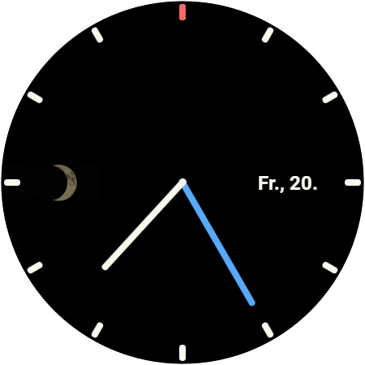

<p align="center">
  
</p>

# workFLOw 01

Analog watchface for Wear OS with moon phases and customizable hand colors.

<p align="center">
  
</p>

## Features

- **Analog clock** with hour, minute, and second hands
- **Moon phase display** with 8 phases and corona effect at new moon
- **Day & weekday** display (German locale, opens calendar on tap)
- **2 complication slots** (top & bottom) for widgets like step count, sunrise/sunset, etc.
- **Always-on display** with simplified hands

## Customization

All settings are accessible via the watchface editor on the watch or phone.

### Position: Moon Phase & Date
Both elements can be placed at any of 4 positions or turned off:
- **Links** (left) — default for moon
- **Rechts** (right) — default for date
- **Oben** (top)
- **Unten** (bottom)
- **Aus** (off)

When the moon is placed on top of a complication slot, that slot is disabled automatically:

| Moon position | Top slot | Bottom slot |
|---------------|----------|-------------|
| Left / Right / Off | on | on |
| Top | **off** | on |
| Bottom | on | **off** |

The date does not disable slots; if placed over a complication it is drawn on top of it.

### Hand Colors
The three hand colors (warm white, blue, red) can be freely assigned:

| Hand | Default | Options |
|------|---------|---------|
| Hour hand | Warm white `#f7f9ef` | Warm white, Blue, Red |
| Minute hand | Blue `#46a9ff` | Warm white, Blue, Red |
| Second hand | Red `#ff6a6a` | Warm white, Blue, Red |

Colors are defined as `ColorConfiguration` and also apply to the always-on display hands.

## Moon Phases

The moon uses an overlay system on top of a full-moon texture (ellipses/rectangles for crescents and quarters, PNG masks for the gibbous phases):

| Phase | Type | Display |
|-------|------|---------|
| 0 | New Moon | Dark with 2px corona glow |
| 1 | Waxing Crescent | Thin bright sliver on right |
| 2 | First Quarter | Right half bright |
| 3 | Waxing Gibbous | Mostly bright, thin dark edge left |
| 4 | Full Moon | Full bright texture |
| 5 | Waning Gibbous | Mostly bright, thin dark edge right |
| 6 | Last Quarter | Left half bright |
| 7 | Waning Crescent | Thin bright sliver on left |

## Building

### Requirements
- Android SDK Build Tools 36.0.0 (`aapt2`) and platform `android-36`
- Java JDK (via Android Studio)
- Signing keystore

### Build
```powershell
# Optional: provide signing passwords via environment (otherwise you are prompted)
$env:WF_STORE_PASS = "..."
$env:WF_KEY_PASS   = "..."   # optional, defaults to WF_STORE_PASS
python build.py
```

Passwords are passed to `jarsigner` via `-storepass:env` / `-keypass:env` and are never stored in the repository.

Version (`versionCode` / `versionName`) and SDK levels are read from `src/AndroidManifest.xml` — bump them there before a release.

Output: `com.watchfacestudio.workFLOw.aab` in the project root (intermediate files in `%TEMP%\workFLOw_build`)

### Validate
```powershell
java -jar wff-validator.jar 5 src/raw/watchface.xml
```
Validator: [google/watchface](https://github.com/google/watchface/tree/main/third_party/wff)

### Install for testing
```bash
# Build APK from AAB with bundletool, or install AAB via Play Console
adb install com.watchfacestudio.workFLOw.apk
```

## Project Structure

```
src/
  AndroidManifest.xml          # App manifest (version, SDK, package)
  raw/watchface.xml            # Main watchface definition (WFF v5)
  xml/                         # Wear OS config XMLs
  drawable-nodpi-v4/           # PNG assets (moon texture, previews)
  values/strings.xml           # English strings (default)
  values-de/strings.xml        # German strings
assets/
  icon.png / icon@2x.png       # App icon (256 / 512px)
  logo.png / logo@2x.png       # Logo (256 / 512px)
  screenshots/                 # Watchface screenshots
docs/
  privacy-policy.html          # Privacy policy (GitHub Pages)
build.py                       # Build script
```

## Technical Details

- **Watch Face Format**: Version 5 (needed for `complicationSlotIds` on `ListOption`)
- **Min SDK**: 36 (Wear OS 6 / Android 16)
- **Current version**: 1.4.0 (versionCode 10000013)
- **Package**: `com.watchfacestudio.workFLOw`
- **Canvas**: 450x450px, circular
- **Clock type**: Analog

## Privacy

This watchface collects no personal data. See [Privacy Policy](https://workflow42.github.io/workFLOw01/privacy-policy.html).

## License

All rights reserved.
